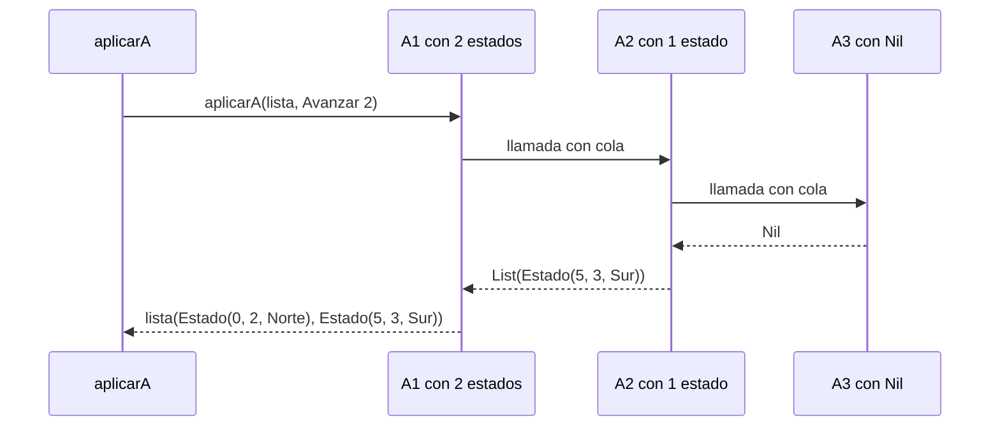
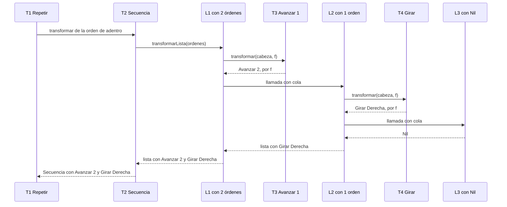
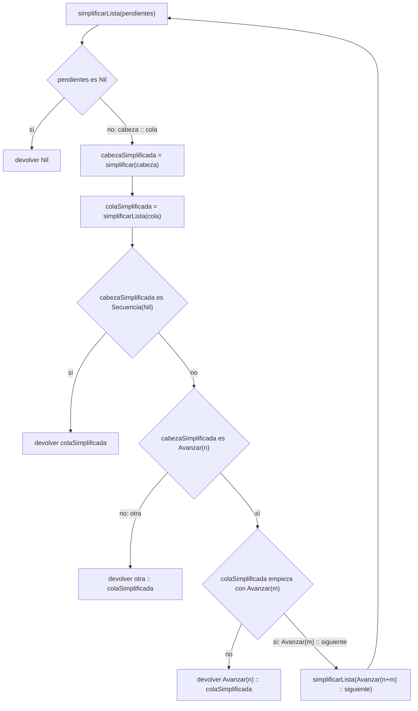

# Punto 4. `aplicarA` y `transformar`

`Estado(x, y, mira)`. El estado inicial es `(0, 0, mira)`. Avanzar hacía el `Norte`, suma a `y`,
hacia el `Sur` resta a `y`, hacia el `Este` suma a `x` y hacia el `Oeste` resta a `x`. En la table `D` es Derecha


#parte 1. `AplicarA`

## 1.1 Definición del Algoritmo

```Scala
  def aplicarA(estados: List[Estado], o: Orden): List[Estado] =
    estados match {
      case Nil =>
        Nil
      case cabeza :: cola =>
        ejecutar(cabeza, o) :: aplicarA(cola, o)
    }

    
```
----
* La función `aplicarA` recibe una lista de estados y orden `o`, y devuelve una lista con el estado que resulta de  
ejecutar `o` sobre cada uno, en el mismo orden. Para ejecutar usa `ejecutar` del punto 2. Una lista vacía o tienen cabeza
cola, así que `match` tiene dos casos.

## 1.2 Explicación paso a paso

### Caso base: `Nil`


```Scala
case Nil =>
        Nil
        
```
No hay estados, así que no hay nada que ejecutar y  el resultado es una lista vacía. Aquí termina la recursión.

### Caso recursivo: `cabeza :: cola`

```Scala
    case cabeza :: cola =>
       ejecutar(cabeza, o) :: aplicarA(cola, o)
       
```

* `cabeza` es el primer estado de la lista y `cola` son los estados que quedan.
* `ejecutar(cabeza, o)` es el estado que resulta de aplicar `o` a la cabeza.
* `aplicarA(cola, o)` hace lo mismo con el resto de la lista.
* El operador `::` pone el estado de la cabeza delante de la lista que vuelve la llamada recursiva. 
Por eso el orden de la lista de salida es el de la entrada.

## 1.3 Seguimiento de las llamadas recursivas

Ejemplo del enunciado:

```Scala
aplicarA(List(inicial, Estado(5, 5, Sur)), Avanzar(2)) 
```

### Paso 1: Llamada inicial 

```Scala
 aplicarA(List(Estado(0, 0, Norte), Estado(5, 5, Sur)), Avanzar(2))  //A1
```
### Paso 2: Bajan las llamadas

```Scala
 // A1: Cabeza = Estado(0, 0, Norte), ejecutar(cabeza, Avanzar(2)) = Estado(0, 2, Norte). Llamada con la cola:
 aplicarA(List(Estado(5, 5, Sur)), Avanzar(2)) // A2
 
 // A2: cabeza = Estado(5, 5, Sur), ejecutar(cabeza, Avanzar(2)) = Estado(5, 5, Sur). Llamada con la cola: 
 // aplicarA(Nil, Avanzar(2))  //A3
```
 Cada llamada ejecuta la orden sobre la cabeza, y el `::` queda pendiente hasta que la llamada con la cola termine.


### Paso 3: Caso base

```Scala
aplicarA(Nil, Avanzar(2)) // A3 devuelve Nil
```
### Paso 4: Suben los resultados

```Scala
// A2: Estado(5, 3, Sur) :: Nil
// = List(Estado(5, 3, Sur))

// A1: Estado(0, 2, Norte) :: List(Estado(5, 3, Sur))
//  =List(Estado(0, 2, Norte), Estado(5, 3, Sur))

```
### Resultado final

  ```Scala
 List(Estado(0, 2, Norte), Estado(5, 3, Sur))
  ```

## 1.4 Comprobación del resultado

### Cómo sale cada estado

| Estado de partida | Mira | Efecto de `Avanzar(2)`| Estado final | 
|---|---|---|---|
| `(0, 0, Norte)` | `(Norte)` | `y` sube: 0 + 2| `(0, 2, Norte)` |
| `(5, 5, Sur)`  | `Sur` | `y` baja: 5 - 2 | `(5, 3, Sur)` |

## Ejemplo de uso con una orden compuesta

```Scala
val o = Secuencia(List(Avanzar(2), Girar(Derecha)))

aplicarA(List(Estado(1, 1, Este), Estado(3, 1, Oeste)), o)
 // List(Estado(3, 1, Sur), Estado(1, 1, Norte))
```

* `Estado(1, 1, Este)` : `Avanzar(2)` lleva `x` de 1 a 3, y `Girar(Derecha)` cambia `Este` por `Sur`.
* `Estado(3, 1, Oeste)`: `Avanzar(2)` lleva `x` de 3 a 1, y `Girar(Derecha)` cambia `Oeste` por `Norte`.

Con la lista vacía el resultado es `Nil`: `aplicarA(Nil, o)` cae directo en el caso base.

## 1.5 Diferencia con recursión de cola

`aplicarA` **no** es de cola: después de `aplicarA(cola, o)` todavía hay que hacer el `::`, así que cada
llamada queda esperando en la pila hasta que la siguiente termine. En el ejemplo A1 y A2 están esperando mientras
A3 devuelve `Nil`. Por eso no lleva `@tailrec`; en `ejecutarLista`, en cambio, la llamada recursiva es lo último que 
se hace y sí está anotada.

## 1.6 Diagrama de llamadas de pila

Las llamadas bajan hasta `Nil` (A3) y los resultados suben.



## Parte 2. `transformar`


## 2.1 Definición del algoritmo

```Scala
   def transformar(o: Orden, f: Orden => Orden): Orden =
    o match {
      case Avanzar(_) =>
        f(o)
      case Girar(_) =>
        f(o)
      case Repetir(veces, orden ) =>
        Repetir(veces, transformar(orden, f))

      case Secuencia(ordenes) =>
        def transformarLista(pendientes: List[Orden]): List[Orden] =

          pendientes match {
            case Nil =>
              Nil

            case cabeza :: cola =>
              transformar(cabeza,f) :: transformarLista(cola)

          }
        Secuencia(transformarLista(ordenes))
    }
```
`transformar` recibe una orden ´o´ y una función `f` de órdenes. Devuelve un orden con la misma estructura, 
pero con cada orden básica (`Avanzar` o `Girar`) reemplazada por lo que devuelva `f`. 
Como `f` es un parámetro, `transformar` es una función de alto orden. `transformarLista` es una función auxiliar dentro 
de `transformar`.


## 2.2 Explicación paso a paso

### Caso base: `Avanzar` y `Girar`


```Scala
      case Avanzar(_) =>
        f(o)
      case Girar(_) =>
        f(o)
```
Las órdenes básicas se entregan a `f`. Es el **único lugar** donde se usa `f`: porque ni `Repetir`
ni `Secuencia` se la pasan.

### Caso recursivo: `Repetir`

```Scala
    case Repetir(veces, orden ) =>
            Repetir(veces, transformar(orden, f))

```
Se conserva `veces` y se transforma la orden de adentro. La forma del `Repetir` no cambia.

### Caso recursivo: `Secuencial`

```Scala
case Secuencia(ordenes) =>
```
Órdenes es la lista de órdenes de la secuencia. La función auxiliar `transformarLista` la recorre.

```Scala
   case Nil =>
      Nil
```
Una lista vacía no tiene nada que transformar. Aquí termina la recursión.

`simplificar` es la orden de adentro ya simplificada, si no quedó nada (`Secuencia(Nil)`), la repetición tampoco hace nada;
si no, se conserva  `Repetir` con `simplificada`.

### Caso recursivo: Secuencia

```Scala
 case Secuencia(ordenes) =>
```

`ordenes` es la lista de órdenes de la secuencia. La función auxiliar `simplificarLista` la recorre.

```Scala
case Nil =>
Nil
```
Una lista vacía no tiene nada que simplificar. Aquí termina la recursión.

```Scala
           case cabeza :: cola =>
              transformar(cabeza,f) :: transformarLista(cola)
```

* `cabeza`  es la primera orden de la lista y `cola` son las órdenes que quedan.
* `transformar(cabeza, f)` transforma la cabeza. Como la cabeza puede ser cualquier orden, vuelve a entrar
al `match` de `transformar`.
* `transformarLista(cola)` transforma el resto de la lista.
* El `::` pone la cabeza transformada delante, así que el orden de la secuencia se conserva. 


```Scala
    Secuencia(transformarLista(ordenes))
```
Con la lista ya transformada se arma de nuevo la `Secuencia`.

## Seguimiento de las llamadas recursivas

Ejemplo del enunciado. La función que se pasa duplicada a cada avance y deja lo demás igual; en la traza la llamamos `f`:


```Scala
  val cuadrado = Repetir(4, Secuencia(List(Avanzar(1), Girar(Derecha))))
   transformar(cuadrado, {
      case Avanzar(n) => Avanzar(2 * n)
      case otra    => otra
   })

```
### Paso 1: Llamada inicial

```Scala

transformar(Repetir(4, Secuencia(List(Avanzar(1), Girar(Derecha)))), f) // T1
```
La orden es un `Repetir`: se guarda el 4 y se transforma lo de adentro.

### Paso 2: Bajan las llamadas

```Scala
// T1: Repetir(4, transformar(orden, f)). Llama con la orden de adentro:
transformar(Secuencia(List(Avanzar(1), Girar(Derecha))), f)// T2

// T2: Secuencia(transformarLista(ordenes)). Llama con la lista de órdenes:
transformarLista(List(Avanzar(1), Girar(Derecha)))  // L1

//L1: cabeza = Avanzar(1). Transforma la cabeza:
transformar(Avanzar(1), f)  // T3, devuelve f(Avanzar(1)) = Avanzar(2) 

//L1: llama con la cola
transformarLista(List(Girar(Derecha)))  // L2

//L2: cabeza = Girar(Derecha). Transforma la cabeza:
transformar(Girar(Derecha), f)  // T4, devuelve f(Girar(Derecha)) = Girar(Derecha)

//L2 llama con la cola:
transformarLista(Nil)  //L3
```
`f` se aplicó solo en T3 y T4, que son las dos órdenes básicas.


### Paso 3: Caso base

```Scala
transformarLista(Nil) // L3 devuelve Nil
```

### Paso 4: Suben los resultados

```Scala
//L2: Girar(Derecha) :: Nil  
// = List(Girar(Derecha))

//L1: Avanzar(2) :: List(Girar(Derecha)) 
// = List(Avanzar(2), Girar(Derecha))

//T2: Secuencia(List(Avanzar(2), Girar(Derecha)))

//T1: Repetir(4, Secuencia(List(Avanzar(2), Girar(Derecha))))
```

### Paso 5. Resultado final

```Scala
 Repetir(4, Secuencia(List(Avanzar(2), Girar(Derecha))))
```
Es el resultado que da el enunciado. La forma (un `Repetir` de 4 veces con una `Secuencia` de dos órdenes) no cambió:
solo cambió el 1 por el 2.

## 2.4 Comprobación del resultado

### Traza de posiciones del robot
Desde `(0, 0, Norte)`. El cuadrado original tiene lado 1 y el transformado, lado 2:

| Orden original | Estado | Orden transformada | Estado | 
|---|---|---|---|
| `Avanzar(1)` | `(0, 1, Norte)` | `Avanzar(2)`| `(0, 2, Norte)` |
| `Girar(D)`   | `(0, 1, Este)` | `Girar(D)` | `(0, 2, Este)` |
| `Avanzar(1)` | `(1, 1, Este)` | `Avanzar(2)`| `(2, 2, Este)` |
| `Girar(D)` | `(1, 1, Sur)` | `Girar(D)` | `(2, 2, Sur)` |
| `Avanzar(1)` | `(1, 0, Sur)` | `Avanzar(2)` | `(2, 0, Sur)` |
| `Girar(D)` | `(1, 0, Oeste)` | `Girar(D)` | `(2, 0, Oeste)` |
| `Avanzar(1)` | `(0, 0, Oeste)` | `Avanzar(2)` | `(0, 0, Oeste)` |
| `Girar(D)` | `(0, 0, Norte)` | `Girar(D)` | `(0, 0, Norte)` |

Las dos órdenes terminan en `(0, 0, Norte)`: dibujan un cuadrado y el robot vuelve al punto de partida.

## Ejemplo de uso

```Scala
transformar(Avanzar(1), f) //Avanzar(2)
transformar(Girar(Derecha), f)  //Girar(Derecha)
transformar(Secuencia(Nil), f) //Secuencia(Nil)
transformar(Repetir(4, Secuencia(Nil)), f) //Repetir(4, Secuencia(Nil))
```
Una secuencia vacía sigue vacía, porque `transformarLista(Nil)` devuelve `Nil` y no se llama a `f`.  


## Diferencia con recursión de cola

* `transformarLista` **no** es de cola: después de `transformarLista(cola)` todavía hay que hacer el `::`, así que las llamadas
quedan pendientes en la pila (ejemplo, L1 y L2 esperan a L3). Además, `transformar` y `transformarLista` se llaman entre sí:
`transformarLista` llama a `transformar` para cada cabeza, y a su vez `transformar` llama a `transformarLista` en el caso `Secuencia`.

## Diagrama de llamados de pila

Las llamadas bajan hasta `Nil` (L3) y los resultados suben.  `f` solo se aplica en T3 y T4.



## Conclusión
`aplicarA` recorre la lista de estados y ejecuta la misma orden sobre cada uno, con un caso para `Nil`
y otro para `cabeza :: cola`, `transformar` recorre la estructura de una orden, aplica `f` solo a las órdenes básicas
y conserva la forma de `Repetir` y `Secuencia`. Ninguna de las dos es de cola, porque en ambas hay que hacer el `::` al 
volver de la recursión.


# Punto 5. `simplificar`.


```Scala
   /** Una orden equivalente más corta, con las reglas del enunciado. */
  def simplificar(o: Orden): Orden = o match {

    case Avanzar(0) =>
      Secuencia(Nil)

    case Avanzar(n) =>
      Avanzar(n)

    case Girar(sentido) =>
      Girar(sentido)

    case Repetir(veces, orden) =>
      if (veces <= 0) {
        Secuencia(Nil)
      } else if (veces == 1) {
        simplificar(orden)
      } else {
        val simplificada = simplificar(orden)

        simplificada match {
          case Secuencia(Nil) =>
            Secuencia(Nil)

          case _ =>
            Repetir(veces, simplificada)
        }
      }
    case Secuencia(ordenes) =>

      def simplificarLista(pendientes: List[Orden]): List[Orden] =

        pendientes match {

          case Nil =>
            Nil

          case cabeza :: cola =>
            val cabezaSimplificada = simplificar(cabeza)
            val colaSimplificada = simplificarLista(cola)

            cabezaSimplificada match {

              case Secuencia(Nil) =>
                colaSimplificada

              case Avanzar(n) =>
                colaSimplificada  match {

                  case Avanzar(m) :: siguiente =>
                    simplificarLista(Avanzar(n + m) :: siguiente)
                  case _ =>
                    Avanzar(n) :: colaSimplificada
                }
              case otra =>
                otra :: colaSimplificada
            }
        }
      val listaSimplificada = simplificarLista(ordenes)

        listaSimplificada match {
        case Nil =>
          Secuencia(Nil)

        case cabeza :: Nil =>
          cabeza

        case _ =>
          Secuencia(listaSimplificada)
      }

    }
    
```
----
  * La función `simplificar` recibe una orden `o` y devuelve otra orden **equivalente**: desde el mismo estado, las
  dos dejan al robot en el mismo estado. Es más corta cuando se puede y queda igual si no hay nada que simplificar. 
  
  No recibe ningún estado: no ejecuta nada, solo reescribe la orden. Como `Orden` es un tipo recursivo usa `match` 
  con un caso por alternativa y se llama a sí misma sobre las órdenes de adentro. `simplificarLista` es una función 
  auxiliar dentro de `simplificar`.

  
## Explicación paso a paso

### Caso base: `Avanzar` y `Girar`


```Scala
case Avanzar(0) =>
Secuencia(Nil)
case Avanzar(n) =>
Avanzar(n)
case Girar(sentido) =>
Girar(sentido)
```
* `Avanzar(0)` no mueve al robot, se cambia por `Secuencia(Nil)`.
* Los demás `Avanzar` y los `Girar` se devuelven iguales.
* El orden importa: `Avanzar(0)` va antes que `Avanzar(n)`, porque si `Avanzar(n)` fuera primero, también atraparía el caso 0.

### Caso recursivo: `Repetir`

```Scala
 if (veces <= 0) {
        Secuencia(Nil)
      }
```
Repetir cero o menos veces no hace nada.  Regla 1 del enunciado `Repetir(0,_)`, pero el código trata todos los casos
con `veces <=0`, porque `ejecutar` también deja igual al robot con repeticiones negativas.

```Scala
else if (veces == 1) {
simplificar(orden)
}
```
Repetir una vez es la orden sola.

```Scala
} else {
        val simplificada = simplificar(orden)
        simplificada match {
          case Secuencia(Nil) =>
            Secuencia(Nil)
          case _ =>
            Repetir(veces, simplificada)
        }
      }
```

`simplificada` es la orden de adentro ya simplificada, si no quedó nada (`Secuencia(Nil)`), la repetición tampoco hace nada; 
si no, se conserva  `Repetir` con `simplificada`.

### Caso recursivo: Secuencia

```Scala
 case Secuencia(ordenes) =>
```

`ordenes` es la lista de órdenes de la secuencia. La función auxiliar `simplificarLista` la recorre.

```Scala
case Nil =>
Nil
```
Una lista vacía no tiene nada que simplificar. Aquí termina la recursión.

```Scala
          case cabeza :: cola =>
            val cabezaSimplificada = simplificar(cabeza)
            val colaSimplificada = simplificarLista(cola)

```

* `cabeza`  es la primera orden de la lista y `cola` es el resto.
* `cabezaSimplificada` como su nombre lo dice, es la cabeza ya simplificada.
* `colaSimplificada` es la cola ya simplificada. Se calcula **antes** de decidir, así que la lista se resuelve 
desde el final hacia el principio.

**Con `cabezaSimplificada` y `colaSimplificada` se decide:**

  **A: si `cabezaSimplificada` no hace nada, se quita.**
    
```Scala
    case Secuencia(Nil) =>
      colaSimplificada

```

  **B: Si  `cabezaSimplificada` es un avance y `colaSimplificada` empieza con otro, se juntan.**
  
  ```Scala
     case Avanzar(n) =>
                colaSimplificada  match {

                  case Avanzar(m) :: siguiente =>
                    simplificarLista(Avanzar(n + m) :: siguiente)
                  case _ =>
                    Avanzar(n) :: colaSimplificada
                }
  ```

  `siguiente` es lo que viene después del segundo avance y  `Avanzar(n + m)` es el avance ya sumado. Al juntarlos se
   vuelve a llamar a  `simplificarLista`, por si el avance nuevo se puede juntar con otro o vale cero. Si  `colaSimplificada` no 
   empieza con un avance  `case _`,  `Avanzar(n)` se queda delante de  `colaSimplificada`.

  **C: Cualquier otra orden se conserva.**

```Scala
    case otra =>
      otra :: colaSimplificada
 ```

  `otra` es cualquier orden que no sea `Secuencia(Nil)` ni `Avanzar`, por ejemplo un `Girar`  o un `Repetir`.

### Resultado final de la secuencia
  ```Scala
  val listaSimplificada = simplificarLista(ordenes)

        listaSimplificada match {
        case Nil =>
          Secuencia(Nil)

        case cabeza :: Nil =>
          cabeza

        case _ =>
          Secuencia(listaSimplificada)
      }
          
  ```

  * Lista vacía (`Nil`): `Secuencia(Nil)`.
  * Un solo elemento (`cabeza:: Nil`): ese elemento, sin la `Secuencia`.
  * Dos o más (`case _`): `Secuencia(listaSimplificada)`.

## Seguimiento de las llamadas recursivas

Ejemplo:

```Scala
simplificar(Secuencia(List(Avanzar(2), Avanzar(3), Avanzar(0), Girar(Derecha))))
```

### Paso 1: Llamada inicial

```Scala

simplificarLista(List(Avanzar(2), Avanzar(3), Avanzar(0), Girar(Derecha))) // L1
```
La orden es una `Secuencia`, así que se llama a `simplificarLista` con su lista.
### Paso 2: Bajan las llamadas

```Scala

// L1: cabeza= Avanzar(2). Llama con la cola:
simplificarLista(List(Avanzar(3), Avanzar(0), Girar(Derecha))) // L2

// L2: cabeza = Avanzar(3). Llama con la cola:
simplificarLista(List(Avanzar(0), Girar(Derecha))) //L3

//L3: cabeza= Secuencia(Nil). Llama con la cola: 
simplificarLista(List(Girar(Derecha))) //L4

//L4: cabeza = Girar(Derecha). Llama con la cola:
simplificarLista(Nil)  //L5

```
  En cada llamada, `cabezaSimplificada = simplificar(cabeza)` y `colaSimplificada = simplificarLista(cola)`. La decisión
  queda pendiente hasta que la llamada con la cola termine.

### Paso 3: Caso base

```Scala
simplificarLista(Nil) // L5 devuelve Nil
```
Aquí termina la bajada: hay cuatro llamadas en la pila (L1 a L4). Desde aquí se resuelven de la más reciente a la más antigua.

### Paso 4: Suben los resultados

```Scala
//L4: cabezaSimplificada = Girar(Derecha) --> es `otra`
//  Girar(Derecha) :: Nil = List(Girar(Derecha))

//L3: cabezaSimplificada = Secuencia(Nil) (porque simplificar(Avanza(0)) = Secuencia(Nil))
//  se quita, devuelve colaSimplificada = List(Girar(Derecha))

//L2: cabezaSimplificada = Avanzar(3), colaSimplificada = List(Girar(Derecha)) no empieza con Avanzar.
//  Avanzar(3) :: List(Girar(Derecha)) = List(Avanzar(3), Girar(Derecha))
```

### Paso 5: Se juntan los avances

```Scala
//L1: cabezaSimplificada = Avanzar(2)
//  colaSimplificada = List(Avanzar(3), Girar(Derecha)) empieza con Avanzar(3), siguiente = List(Girar(Derecha))
//  se juntan: Avanzar(2 + 3) = Avanzar(5), y se vuelve a llamar:
simplificarLista(List(Avanzar(5), Girar(Derecha))) //L6

//L6: cabeza = Avanzar(5). Llama con la cola:
simplificarLista(List(Girar(Derecha)))
//L7: cabeza = Girar(Derecha). Llama con la cola:
simplificarLista(Nil)

//L7: Girar(Derecha) :: Nil = List(Girar(Derecha))
//L6: Avanzar(5) no se junta con Girar -> Avanzar(5) :: List(Girar(Derecha)) 
//  = List(Avanzar(5), Girar(Derecha))

```
La llamada extra (L6) revisa la lista nueva, por si el avance sumado se pudiera juntar con otro o valiera cera.

### Paso 6: Resultado final 

```Scala
//L1 devuelve lo de L6: List(Avanzar(5), Girar(Derecha))
// simplificar: listaSimplificada tiene dos elementos (case_) -> Secuencia(listaSimplificada)
Secuencia(List(Avanzar(5), Girar(Derecha)))
```

`simplificarLista` devolvió una lista de órdenes; `simplificar` es la que construye la `Secuencia` final.
Quedaron dos elementos, por eso se arma una  `Secuencia`.

## Comprobación del resultado 

### Traza de posiciones del robot
Desde `(0, 0, Norte)`:

| Orden original | Estado | Orden simplificada | Estado | 
|---|---|---|---|
| `Avanzar(2)` | `(0, 2, Norte)` | | |
| `Avanzar(3)` | `(0, 5, Norte)` | `Avanzar(5)` | `(0, 5, Norte)` |
| `Avanzar(0)` | `(0, 5, Norte)` | | |
| `Girar(D)`   | `(0, 5, Este)` | `Girar(D)` | `(0, 5, Este)` |

Las dos órdenes terminan en `(0, 5, Este)`.

## Ejemplo de uso

```Scala
val resultado = simplificar(
Secuencia(List(Avanzar(1), Avanzar(2), Girar(Derecha), Avanzar(3)))
)
println(resultado)  // Secuencia(List(Avanzar(3), Girar(Derecha), Avanzar(3)))
```
Los dos primeros avances se juntan; el último queda aparte porque hay un giro en medio.

## Ejemplo con `Repetir`

```Scala
simplificar(Repetir(3, Secuencia(List(Avanzar(1), Avanzar(1)))))
 // Repetir(3, Avanzar(2))
```
`veces` es 3, así que se simplifica la orden de adentro: la `Secuencia` junta los dos avances en `Avanzar(2)`,
y como no quedó `Secuencia(Nil)` se conserva el `Repetir`. Las dos órdenes llevan al robot de (0, 0, Norte) a (0, 6, Norte).


## Ejemplos del enunciado

| Entrada | Salida | 
|---|---|
| `Secuencia(List(Avanzar(2), Avanzar(3)))` | `Avanzar(5)` | 
| `Repetir(1, Avanzar(4))` | `Avanzar(4)` |
| `Secuencia(List(Avanzar(0), Girar(Derecha)))` | `Girar(Derecha)` | 
| `Secuencia(List(Avanzar(1), Avanzar(2), Girar(Derecha), Avanzar(3)))`  | `Secuencia(List(Avanzar(3), Girar(Derecha), Avanzar(3)))` |
| `Repetir(0, Avanzar(9))` | `Secuencia(Nil)` |


## Diferencia con recursión de cola

* `simplificarLista` **no** es de cola: después de `simplificarLista(cola)` todavía decide qué hacer con `cabezaSimplificada`. Por 
eso las llamadas quedan pendientes en la pila: en el ejemplo L1 a L5 están esperando a la vez.
* Además, al juntar dos avances se llama de nuevo a `simplificarLista`, y esa llamada vuelve a calcular su propio `colaSimplificada`,
que también está pendiente (como L6 a L8)

## Diagrama de llamados de pila 

Las llamadas bajan hasta `Nil` (L5) y los resultados suben.  `simplificarLista` devuelve una lista de órdenes y `simplificar`
construye la `Secuencia` final.


## Diagrama de decisión de `simplificarLista`

Qué hace `simplificarLista` con cada lista que recibe.



##  Conclusión

`simplificar` quita las órdenes que no hacen nada y junta los avances seguidos, usando recursión y `match`.
La auxiliar `simplificarLista` no es de cola: decide sobre cada orden al volver de la recursión. El resultado es 
una orden que deja al robot en el mismo estado que la original.