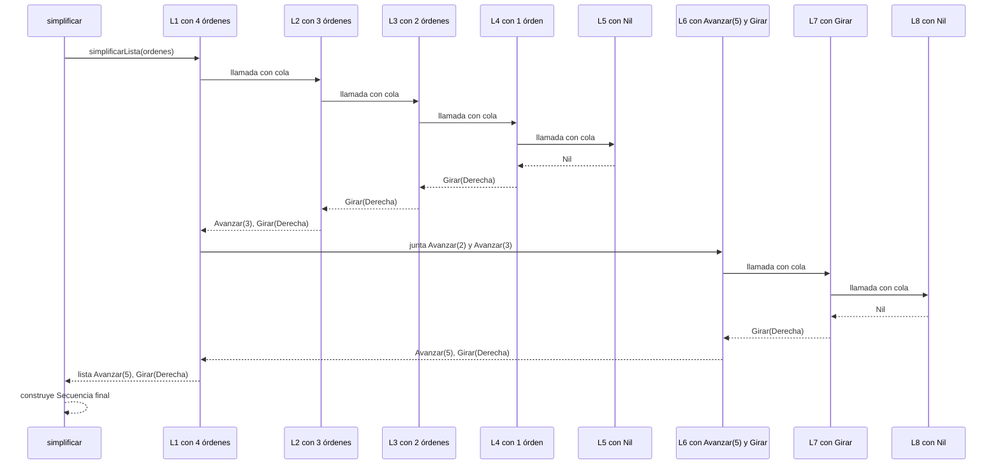
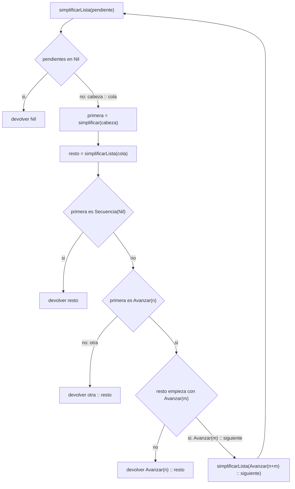

# Punto 5. `simplificar`

Un estado se escribe `(x, y, mira)`: posición `(x, y)` y dirección `mira`.
El estado inicial es `(0,0, Norte)`, Avanzar hacia el `Norte` suma a `y`, cuando va
hacia el `Este` suma a  `x`. Para abreviar, en las tablas `D` es `Derecha`.

## Definición del Algoritmo

```Scala
  def simplificar(o: Orden): Orden = o match {
    case Avanzar(0) =>
      Secuencia(Nil)
    case Avanzar(n) =>
      Avanzar(n)
    case Girar(sentido) =>
      Girar(sentido)
    case Repetir(veces, orden) =>
      if (veces <= 0) {
        Secuencia(Nil)
      } else if (veces == 1) {
        simplificar(orden)
      } else {
        val simplificada = simplificar(orden)
        simplificada match {
          case Secuencia(Nil) =>
            Secuencia(Nil)
          case _ =>
            Repetir(veces, simplificada)
        }
      }
    case Secuencia(ordenes) =>
      def simplificarLista(pendientes: List[Orden]): List[Orden] = {
        pendientes match {
          case Nil =>
            Nil
          case cabeza :: cola =>
            val primera = simplificar(cabeza)
            val resto = simplificarLista(cola)
            primera match {
              case Secuencia(Nil) =>
                resto
              case Avanzar(n) =>
                resto match {
                  case Avanzar(m) :: siguiente =>
                    simplificarLista(Avanzar(n + m) :: siguiente)
                  case _ =>
                    Avanzar(n) :: resto
                }
              case otra =>
                otra :: resto
            }
        }
      }
      val resultado = simplificarLista(ordenes)

      resultado match {
        case Nil =>
          Secuencia(Nil)
        case cabeza :: Nil =>
          cabeza
        case _ =>
          Secuencia(resultado)
      }     
}
```

  * La función `simplificar` recibe una orden `o` y devuelve otra orden **equivalente**: desde el mismo estado, las
  dos dejan al robot en el mismo estado. Es más corta cuando se puede y queda igual si no hay nada que simplificar. 
  
  No recibe ningún estado: no ejecuta nada, solo reescribe la orden. Como `Orden` es un tipo recursivo usa `match` 
  con un caso por alternativa y se llama a sí misma sobre las órdenes de adentro. `simplificarLista` es una función 
  auxiliar dentro de `simplificar`.

  
## Explicación paso a paso

### Caso base: `Avanzar` y `Girar`


```Scala
case Avanzar(0) =>
Secuencia(Nil)
case Avanzar(n) =>
Avanzar(n)
case Girar(sentido) =>
Girar(sentido)
```
* `Avanzar(0)` no mueve al robot, se cambia por `Secuencia(Nil)`.
* Los demás `Avanzar` y los `Girar` se devuelven iguales.
* El orden importa: `Avanzar(0)` va antes que `Avanzar(n)`, porque si `Avanzar(n)` fuera primero, también atraparía el caso 0.

### Caso recursivo: `Repetir`

```Scala
 if (veces <= 0) {
        Secuencia(Nil)
      }
```
Repetir cero o menos veces no hace nada.  Regla 1 del enunciado `Repetir(0,_)`, pero el código trata todos los casos
con `veces <=0`, porque `ejecutar` también deja igual al robot con repeticiones negativas.

```Scala
else if (veces == 1) {
simplificar(orden)
}
```
Repetir una vez es la orden sola.

```Scala
} else {
        val simplificada = simplificar(orden)
        simplificada match {
          case Secuencia(Nil) =>
            Secuencia(Nil)
          case _ =>
            Repetir(veces, simplificada)
        }
      }
```
`simplificada` es la orden de adentro ya simplificada, si no quedó nada (`Secuencia(Nil)`), la repetición tampoco hace nada; 
si no, se conserva  `Repetir` con `simplificada`.

### Caso recursivo: Secuencia

```Scala
 case Secuencia(ordenes) =>
```

`ordenes` es la lista de órdenes de la secuencia. La función auxiliar `simplificarLista` la recorre.

```Scala
case Nil =>
Nil
```
Una lista vacía no tiene nada que simplificar. Aquí termina la recursión.

```Scala
case cabeza :: cola =>
            val primera = simplificar(cabeza)
            val resto = simplificarLista(cola)
```
* `cabeza`  es la primera orden de la lista y `cola` es el resto.
* `primera` es la cabeza ya simplificada.
* `resto` es la cola ya simplificada. Se calcula **antes** de decidir, así que la lista se resuelve desde el final hacia
el principio.

**Con `primera` y `resto` se decide:**

  **A: si `primera` no hace nada, se quita.**
    
```Scala
       case Secuencia(Nil) =>
       resto
```

  **B: Si  `primera` es un avance y  `resto` empieza con otro, se juntan.**
  
  ```Scala
     case Avanzar(n) =>
                  resto match {
                    case Avanzar(m) :: siguiente =>
                      simplificarLista(Avanzar(n + m) :: siguiente)
                    case _ =>
                      Avanzar(n) :: resto
              }
  ```

  `siguiente` es lo que viene después del segundo avance y  `Avanzar(n + m)` es el avance ya sumado. Al juntarlos se
   vuelve a llamar a  `simplificarLista`, por si el avance nuevo se puede juntar con otro o vale cero. Si  `resto` no 
   empieza con un avance  `case _`,  `Avanzar(n)` se queda delante de  `resto`.

  **C: Cualquier otra orden se conserva.**

```Scala
     case otra =>
    otra :: resto
              
 ```

  `otra` es cualquier orden que no sea `Secuencia(Nil)` ni `Avanzar`, por ejemplo un `Girar`  o un `Repetir`.

### Resultado final de la secuencia
  ```Scala
   val resultado = simplificarLista(ordenes)

      resultado match {
        case Nil =>
          Secuencia(Nil)
        case cabeza :: Nil =>
          cabeza
        case _ =>
          Secuencia(resultado)
      }
  ```

  * Lista vacía (`Nil`): `Secuencia(Nil)`.
  * Un solo elemento (`cabeza:: Nil`): ese elemento, sin la `Secuencia`.
  * Dos o más (`case _`): `Secuencia(resultado)`.

## Seguimiento de las llamadas recursivas

Ejemplo:

```Scala
simplificar(Secuencia(List(Avanzar(2), Avanzar(3), Avanzar(0), Girar(Derecha))))
```

### Paso 1: Llamada inicial

```Scala

simplificarLista(List(Avanzar(2), Avanzar(3), Avanzar(0), Girar(Derecha))) // L1
```
La orden es una `Secuencia`, así que se llama a `simplificarLista` con su lista.
### Paso 2: Bajan las llamadas

```Scala
// L1: primera = Avanzar(2). Llama con la cola:
simplificarLista(List(Avanzar(3), Avanzar(0), Girar(Derecha))) // L2

// L2: primera = Avanzar(3). Llama con la cola:
simplificarLista(List(Avanzar(0), Girar(Derecha))) //L3

//L3: primera = Secuencia(Nil). Llama con la cola: 
simplificarLista(List(Girar(Derecha))) //L4

//L4: primera = Girar(Derecha). Llama con la cola:
simplificarLista(Nil)  //L5

```
  Cada llamada simplifica su cabeza y llama con la cola. La decisión sobre esa cabeza queda pendiente.
### Paso 3: Caso base

```Scala
simplificarLista(Nil) // devuelve Nil
```
Aquí termina la bajada: hay cinco llamadas en la pila (L1 a L5). Desde aquí se resuelven de la más reciente a la más antigua.

### Paso 4: Suben los resultados

```Scala
//L4: Girar(Derecha) es "otra"   -> List(Girar(Derecha))
//L3: Secuencia(Nil) se quita     -> List(Girar(Derecha))
//L2: Avanzar(3), resto no empieza con Avanzar  -> List(Avanzar(3), Girar(Derecha))
```
Cada llamada aplica la decisión que tenía pendiente (caso A, B o C).

### Paso 5: Se juntan los avances

```Scala
//L1: Avanzar(2), y resto es List(Avanzar(3), Girar(Derecha)). Empieza con un avance, así que se aplica el caso B.
simplificarLista(List(Avanzar(5), Girar(Derecha))) // L6, devuelve List(Avanzar(5), Girar(Derecha))
```
L6 es una llamada nueva y también tiene si propia bajada: simplifica Avanzar(5) y llama con la cola (L7, con 
Girar(Derecha)), que a su vez llama con Nil (L8). Al volver, Avanzar(5) no puede juntarse con Girar(Derecha),
así que L6 devuelve List(Avanzar(5), Girar(Derecha)).

### Paso 6: Resultado final 

```Scala
Secuencia(List(Avanzar(5), Girar(Derecha)))
```

`simplificarLista` devolvió una lista de órdenes; `simplificar` es la que construye la `Secuencia` final.
Quedaron dos elementos, por eso se arma una  `Secuencia`.

## Comprobación del resultado 

### Traza de posiciones del robot
Desde `(0, 0, Norte)`:

| Orden original | Estado | Orden simplificada | Estado | 
|---|---|---|---|
| `Avanzar(2)` | `(0, 2, Norte)` | | |
| `Avanzar(3)` | `(0, 5, Norte)` | `Avanzar(5)` | `(0, 5, Norte)` |
| `Avanzar(0)` | `(0, 5, Norte)` | | |
| `Girar(D)`   | `(0, 5, Este)` | `Girar(D)` | `(0, 5, Este)` |

Las dos órdenes terminan en `(0, 5, Este)`.

## Ejemplo de uso

```Scala
val resultado = simplificar(
Secuencia(List(Avanzar(1), Avanzar(2), Girar(Derecha), Avanzar(3)))
)
println(resultado)  // Secuencia(List(Avanzar(3), Girar(Derecha), Avanzar(3)))
```

Los dos primeros avances se juntan; el último queda aparte porque hay un giro en medio.

## Ejemplos del enunciado

| Entrada | Salida | 
|---|---|
| `Secuencia(List(Avanzar(2), Avanzar(3)))` | `Avanzar(5)` | 
| `Repetir(1, Avanzar(4))` | `Avanzar(4)` |
| `Secuencia(List(Avanzar(0), Girar(Derecha)))` | `Girar(Derecha)` | 
| `Secuencia(List(Avanzar(1), Avanzar(2), Girar(Derecha), Avanzar(3)))`  | `Secuencia(List(Avanzar(3), Girar(Derecha), Avanzar(3)))` |
| `Repetir(0, Avanzar(9))` | `Secuencia(Nil)` |


## Diferencia con recursión de cola

* `simplificarLista` **no** es de cola: después de `simplificarLista(cola)` todavía decide qué hacer con `primera`. Por 
eso las llamadas quedan pendientes en la pila: en el ejemplo L1 a L5 están esperando a la vez.
* Además, al juntar dos avances se llama de nuevo a `simplificarLista`, y esa llamada vuelve a calcular su propio `resto`,
que también está pendiente (como L6 A L8)

## Diagrama de llamados de pila 

Las llamadas bajan hasta `Nil` (L5) y los resultados suben.  `simplificarLista` devuelve una lista de órdenes y `simplificar`
construye la `Secuencia` final.


## Diagrama de decisión de `simplificarLista`

Qué hace `simplificarLista` con cada lista que recibe.



##  Conclusión
`simplificar` quita las órdenes que no hacen nada y junta los avances seguidos, usando recursión y `match`.
La auxiliar `simplificarLista` no es de cola: decide sobre cada orden al volver de la recursión. El resultado es 
una orden que deja al robot en el mismo estado que la original.