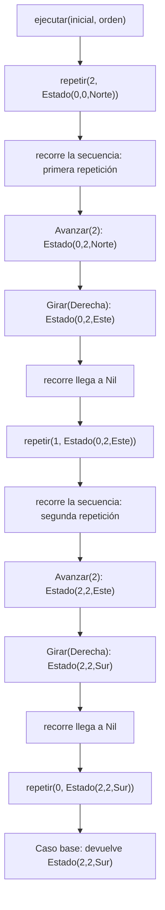
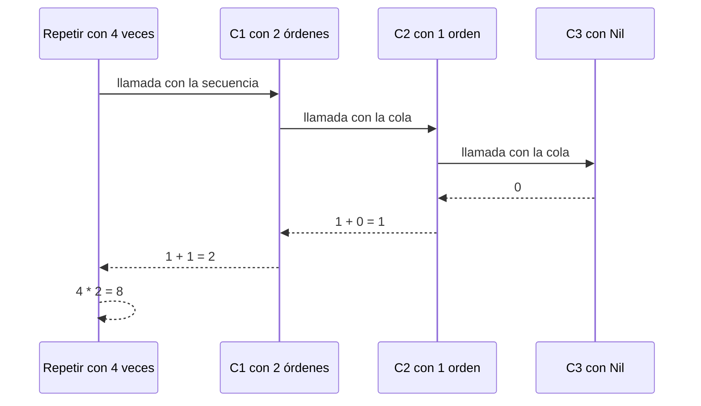
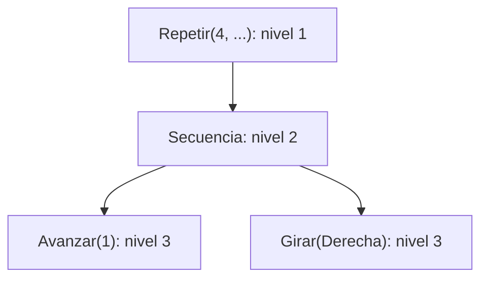
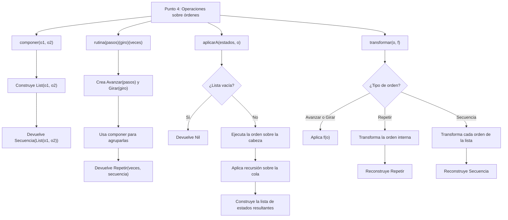
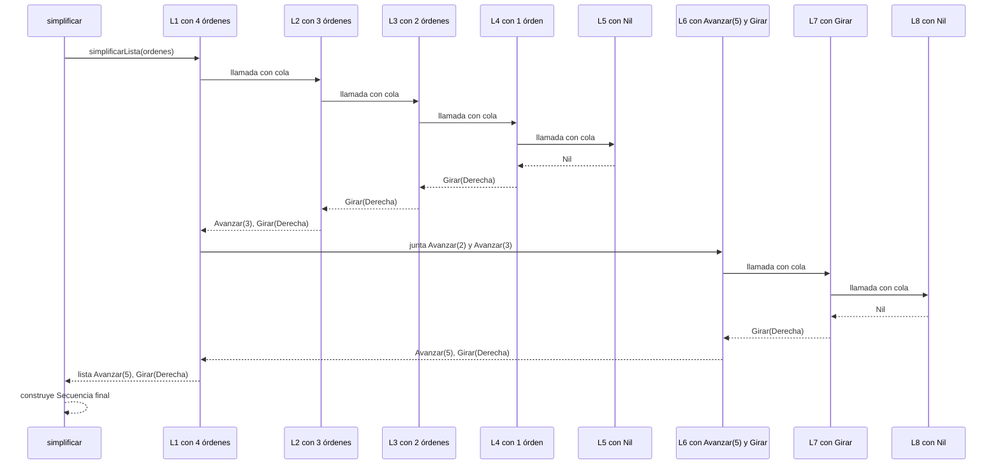
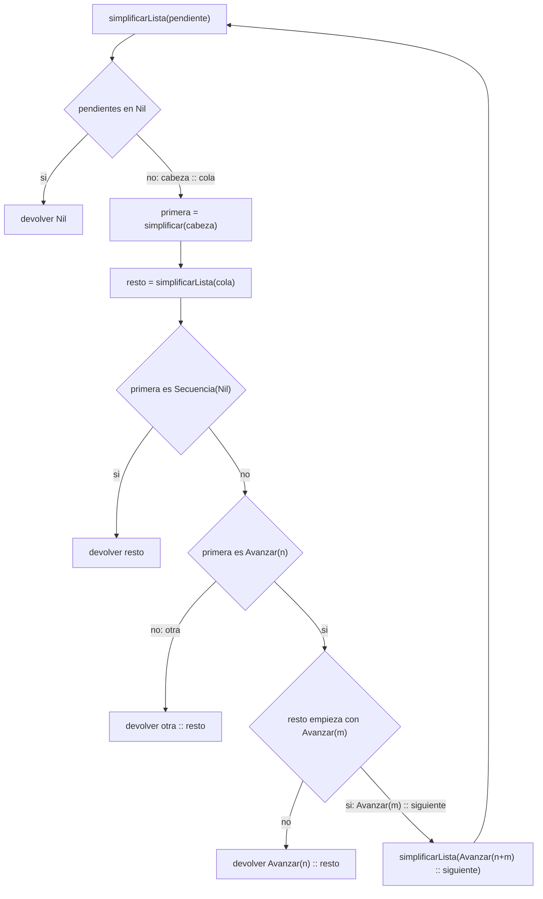

# Informe de proceso: Taller 2, un robot en la cuadrícula

Un robot se mueve por una cuadrícula infinita de coordenadas enteras. Siempre ocupa una
posición y mira hacia uno de los cuatro puntos cardinales. Entiende cuatro órdenes:
`Avanzar(n)`, `Girar(sentido)`, `Repetir(veces, orden)` y `Secuencia(ordenes)`. Las dos
últimas contienen otras órdenes, por eso el tipo `Orden` es recursivo y las funciones que
lo recorren también.

Un estado se escribe `(x, y, mira)`: posición `(x, y)` y dirección `mira`.
El estado inicial es `(0, 0, Norte)`. `Avanzar` hacia el `Norte` suma a `y` y hacia el
`Este` suma a `x`; hacia el `Sur` resta a `y` y hacia el `Oeste` resta a `x`.

Cada punto del taller tiene su sección, con la misma estructura.

Para abreviar, en las tablas `D` es `Derecha` e `I` es `Izquierda`.

# Punto 1. `girar`

## Definición del Algoritmo

```Scala 
  def girar(d: Direccion, s: Sentido): Direccion = (d, s) match {
    case (Norte, Derecha) => Este
    case (Norte, Izquierda) => Oeste
    case (Sur, Derecha) => Oeste
    case (Sur, Izquierda) => Este
    case (Este, Derecha) => Sur
    case (Este, Izquierda) => Norte
    case (Oeste, Derecha) => Norte
    case (Oeste, Izquierda) => Sur
  }
```

`girar` recibe una dirección `d` y un sentido `s` y devuelve la dirección en la que 
queda mirando el robot después de girar 90 grados. No recibe una posición y no mueve
al robot: solo cambia hacia dónde mira. 

`match (d, s)` compara la pareja formada por la dirección y el sentido contra cada
`case`, de arriba hacia abajo, y devuelve el resultado del primero que coincide. Hay 4 direcciones y
2 sentidos, así que hay 8 combinaciones y cada una tiene su `case`.

## Explicación paso a paso
| Dirección | Sentido     | Resultado  |
|-----------|-------------|------------|
| `Norte`   | `D`   | `Este`     |
| `Norte`   | `I` | `Oeste`    |
| `Sur`     | `D`   | `Oeste`    |
| `Sur`     | `I`  |`Este`|
| `Este`    | `D`   |`Sur`|
| `Este`    |`I`  |`Norte`|
| `Oeste`   | `D`   |`Norte`|
| `Oeste`   | `I` |`Sur`|

Las direcciones forman un círculo: `Norte` -> `Este` -> `Sur` -> `Oeste` -> `Norte`.
Girar a la `Derecha` lleva a la siguiente dirección de ese círculo y girar a la 
`Izquierda` lleva a la anterior.

`Derecha` e `Izquierda` son los dos sentidos de giro, y cada giro es de 90 grados.

Los tipos de `d` y `s` los declara la firma de la función: `d` es una `Direccion` y `s` es un 
`Sentido`. Ambos se definen con `sealed trait` y sus valores (`Norte`, `Derecha`, etc.) son `case object`.
Por eso el compilador conoce todas las alternativas y avisa si falta alguna de las 8 combinaciones.

## Comprobación del resultado

### Traza de posiciones del robot

`girar` no mueve el robot, así que se toma la posición `(0,0)` solo para mostrar que 
`x` e `y` no cambian. 

| Orden                     | Estado antes    | Estado después  |
|---------------------------|-----------------|-----------------|
| `girar(Norte, D)`   | `(0, 0, Norte)` | `(0, 0, Este)`  |
| `girar(Norte, I)` | `(0, 0, Norte)` | `(0, 0, Oeste)` |
| `girar(Oeste, D)`   | `(0, 0, Oeste)` | `(0, 0, Norte)` |
| `girar(Sur, I)`   | `(0, 0, Sur)`   | `(0, 0, Este)`  |

En los cuatro casos `x` e `y` no cambian; solo cambia la dirección.

## Ejemplo de uso

```Scala
val robot = new RobotCuadricula
println(robot.girar(Oeste, Derecha))  // El resultado será: Norte
```

## Ejemplos del enunciado

| Entrada           | Salida  |
|-------------------|---------|
| `girar(Norte, D)` | `Este`  |
| `girar(Norte, I)` | `Oeste` |
| `girar(Oeste, D)` | `Norte` |
| `girar(Sur, I)`   | `Este`  |

## Conclusión
`girar` devuelve la dirección que queda tras un giro de 90 grados. Se hace uso de `match` sobre 
la pareja `(d,s)`, con un `case` por cada una de las 8 combinaciones.

# Punto 2. Ejecutar

## Definición del algoritmo

La función ejecutar recibe el estado actual del robot y una orden, y devuelve el estado resultante después de 
realizarla. Este tiene una posición (x, y) y una dirección hacia la que mira.

Dependiendo de la orden, puede avanzar, girar y repetir una instrucción o ejecutar una lista de instrucciones.

```Scala
def ejecutar(e: Estado, o: Orden): Estado = o match {

  case Avanzar(n) =>
    e.mira match {
      case Norte => e.copy(y = e.y + n)
      case Sur   => e.copy(y = e.y - n)
      case Este  => e.copy(x = e.x + n)
      case Oeste => e.copy(x = e.x - n)
    }

  case Girar(sentido) =>
    e.copy(mira = girar(e.mira, sentido))

  case Repetir(veces, orden) =>
    @annotation.tailrec
    def repetir(restantes: Int, actual: Estado): Estado =
      if (restantes <= 0) {
        actual
      } else {
        repetir(restantes - 1, ejecutar(actual, orden))
      }

    repetir(veces, e)

  case Secuencia(ordenes) =>
    @annotation.tailrec
    def recorre(
        pendientes: List[Orden],
        actual: Estado
    ): Estado =
      pendientes match {
        case Nil =>
          actual

        case x :: xs =>
          recorre(xs, ejecutar(actual, x))
      }

    recorre(ordenes, e)
}
```
La función usa $match$ para reconocer los 4 tipos de órdenes. Las 2 primeras se ejecutan directamente, mientras que 
$Repetir$ y $Secuencia$ necesitan funciones auxiliares recursivas.

Se usa $e.copy$ para construir el nuevo estado con los cambios correspondientes, conservando los atributos 
que no necesitan modificarse

El algoritmo no emplea var, while ni return. El estado actualizado se transmite mediante los 
parámetros de las funciones

## Explicación paso a paso

### Caso 1: Avanzar(n)

Cuando el robot recibe $Avanzar(n)$, primero se identifica la dirección hacia la que está mirando mediante 
$e.mira$ y $match$

| Dirección | Operación realizada | Coordenada modificada |
|-----------|---------------------|-----------------------|
| `Norte`   | $y+n$               | $y$                   |
| `Sur`     | $y-n$               | $y$                   |
| `Este`    | $x+n$               | $x$                   |
| `Oeste`   | $x-n$               | $x$                   |

Ejemplo:
```Scala
  ejecutar(Estado(2, 3, Norte), Avanzar(4))
```
El robot comienza en (2, 3) mirando al norte. Como debe de avanzar 4 unidades, se suma 4 a la coordenada $y$
$y = 3 + 4 = 7$

Dando como resultado: 
```Scala
  Estado(2, 7, Norte)
```
Si $n$ es negativo, el robot retrocede sin cambiar la dirección

Ejemplo
```Scala
  ejecutar(Estado(5, -1, Oeste), Avanzar(-3))
```
Como mira hacia el $Oeste$, el programa realiza:
$x = 5 - (-3)$
$x = 8$

El estado resultante es Estado(8, -1, Oeste)

### Caso 2: Girar(sentido)

Cuando se recibe una orden $Girar$, el programa usa la función $girar$ desarrollada en el punto 1

```Scala
  case Girar(sentido) =>
    e.copy(mira = girar(e.mira, sentido))
```
Esta calcula la nueva dirección, mientras que $copy$ mantiene las coordenadas anteriores

Ejemplo:
```Scala
  ejecutar(Estado(4, 7, Este), Girar(Izquierda))
```
Dando como resultado: $Estado(4, 7, Norte)$

El robot está mirando al $Este$. Al girar a la izquierda, comienza a mirar al $Norte$ 

### Caso 3: Repetir(veces, orden)

Este permite ejecutar varias veces una misma instrucción.
Como se necesita recordar cuantas repeticiones falta y cual es su estado actual, se usa la función auxiliar $repetir$

```Scala
  @annotation.tailrec
  def repetir(restantes: Int, actual: Estado): Estado =
    if (restantes <= 0) {
        actual
  } else {
    repetir(restantes - 1, ejecutar(actual, orden))
  }
```
Se sabe que la función tiene los siguientes parámetros:
- $restantes$: Índica cuantas repeticiones quedan pendientes
- $actual$: Guarda el estado obtenido después de ejecutar las instrucciones anteriores

Entonces:
- Si $restantes$ es 0 o negativo, devuelve el estado actual, sin hacer ningún cambio u operación adicional.
- Si no entonces primero se ejecuta la orden y después llama nuevamente a $repetir$ con una repetición menos

La llamada $repetir(veces, e)$ inicia el proceso con la cantidad de repeticiones solicitadas y el estado 
recibido por $ejecutar$

Ejemplo:
```Scala
  val estado = Estado(1, 2, Este)
  val orden = Repetir(3, Avanzar(2))
```

| Repetición | Estado obtenido | Pendientes |
|------------|-----------------|------------|
| Inicial    | (1, 2, Este)    | 3          |
| Primera    | (3, 2, Este)    | 2          |
| Segunda    | (5, 2, Este)    | 1          |
| Tercera    | (7, 2, Este)    | 0          |

Cuando $restantes$ llega a 0, devuelve Estado(7, 2, Este)

### Caso 4: Secuencia(ordenes)

Se sabe que una secuencia permite ejecutar varias instrucciones en el orden que aparezcan en una lista,
para recorrer las se usa la función auxiliar $recorre$

```Scala
@annotation.tailrec
def recorre(
    pendientes: List[Orden],
    actual: Estado
): Estado =
  pendientes match {
    case Nil =>
      actual

    case x :: xs =>
      recorre(xs, ejecutar(actual, x))
  }
```
Como tal recibe la lista de instrucciones pendientes y el estado actual, para luego usar 2 patrones:
- $Nil$: Indica si la lista está vacía. En este caso se devuelve el estado actual
- $x :: xs$: Separa la cabeza $x$ (contiene la primera orden), de la cola xs (contiene las instrucciones restantes)

Cuando aparece $x :: xs$, primero se ejecuta $x$ sobre el estado actual; 
Luego llama a $recorre(xs, ejecutar(actual, x))$, utilizando la lista restante y el nuevo estado obtenido. 

Con esto se inicia el recorrido de la lista completa desde el estado original

Ejemplo:

```Scala
val estado = Estado(2, 3, Norte)
val orden = Secuencia(List(Avanzar(2), Girar(Derecha)))
```

| Paso    | Instrucción      | Estado obtenido | Pendientes |
|---------|------------------|-----------------|------------|
| Inicial | —                | (2, 3, Norte)   | 2          |
| Primera | `Avanzar(2)`     | (2, 5, Norte)   | 1          |
| Segunda | `Girar(Derecha)` | (2, 5, Este)    | 0          |

Al llegar a $Nil$, la función devuelve Estado(2, 5, Este)

## Seguimiento de las llamadas recursivas

Para observar como trabajan juntas $Repetir$ y $Secuencia$, utilizamos una orden que contiene ambas estructuras 

```Scala
val orden = Repetir(2, Secuencia(List(Avanzar(2), Girar(Derecha))))
ejecutar(inicial, orden)
```
Siendo el estado inicial Estado(0, 0, Norte)

#### Paso 1: Llamada inicial

La función reconoce que la orden es $Repetir$ e inicia su auxiliar

```Scala
repetir(2, Estado(0, 0, Norte))
```
Como quedan 2 repeticiones, entonces ejecuta la secuencia interna


#### Paso 2: Primera repetición

La secuencia contiene 2 órdenes

```Scala
List(Avanzar(2), Girar(Derecha))
```
Entonces:
```Scala
// Primero ejecuta Avanzar(2)
Estado(0, 0, Norte)
// Se convierte en
Estado(0, 2, Norte)
// Despues ejecuta $Girar(Derecha)$
Estado(0, 2, Este)
```
Entonces cuando llega a $Nil$, $recorre$ devuelve ese estado y la función 
$repetir$ continua con una repetición menos

```Scala
repetir(1, Estado(0, 2, Este))
```

#### Paso 3: Segunda repetición
Nuevamente, se ejecuta la misma secuencia, sin embargo, ahora comienza mirando al $Este$ 

```Scala
// Primero avanza 2 unidades
Estado(2, 2, Este)
// Después gira a la derecha
Estado(2, 2, Sur)
```
Al completar la secuencia, se hace la siguiente llamada 

```Scala
repetir(0, Estado(2, 2, Sur))
```

#### Paso 4: Caso base y resultado
Como $restantes$ es 0, la condición

```Scala
if (restantes <= 0)
```
Se cumple, entonces se devuelve el estado actual $Estado(2, 2, Sur)$

De esta forma $Repetir$ controla las veces que se ejecuta la instrucción 
y $Secuencia$ controla el orden de las operaciones internas

## Comprobación del resultado

### Traza de posiciones del robot

Para corroborar el ejemplo anterior se muestra cada movimiento y giro realizado desde el estado inicial

| Paso | Orden ejecutada  | Estado del robot |
|------|------------------|------------------|
| 0    | Inicio           | (0, 0, Norte)    |
| 1    | `Avanzar(2)`     | (0, 2, Norte)    |
| 2    | `Girar(Derecha)` | (0, 2, Este)     |
| 3    | `Avanzar(2)`     | (2, 2, Este)     |
| 4    | `Girar(Derecha)` | (2, 2, Sur)      |

Evidenciándose que termina en (2, 2) mirando hacia el $Sur$.

Las 2 repeticiones ejecutaron exactamente la misma lista de órdenes, los movimientos dieron resultados distintos 
porque la dirección se cambió al finalizar la primera repetición

Ejemplo de uso:

```Scala
val robot = new RobotCuadricula
val orden = Repetir(2, Secuencia(List(Avanzar(2), Girar(Derecha))))

println(robot.ejecutar(robot.inicial, orden))
//Estado(2, 2, Sur)
```

## Diagrama de llamados recursivos

El siguiente diagrama representa el orden lógico de las llamadas al ejecutar 2 veces la secuencia de avanzar y girar


Se sabe que $repetir$ y $recorre$ usa recursión de cola (la llamada recursiva es la última 
que se ejecuta en cada rama). La anotación $@annotation.tailrec$ permite que Scala compruebe esta propiedad 

El diagrama representa el recorrido de las llamadas, esto no significa que todas las llamadas de las funciones 
auxiliares deban guardarse en la memoria del computador

Las órdenes internas pueden contener otras órdenes compuestas, por lo que $ejecutar$ puede volverl a 
llamarse para procesarlas

## Terminación
En $Repetir$, el número de repeticiones disminuye en cada llamada: $2 \Rightarrow 1 \Rightarrow 0$, 
y que cuando llega a 0 devuelve el estado actual. Si la cantidad inicial es cero o negativa, termina inmediatamente 

En $Secuencia$, la lista de ordenes pendientes se reduce al procesar su cabeza

```Scala
List(Avanzar(2), Girar(Derecha))
List(Girar(Derecha))
Nil
```
Y que cuando llega a $Nil$, devuelve el último resultado obtenido. 

Como las ordenes y sus listas internas son finitas y cada contador positivo disminuye, 
la ejecución termina después de completar las instrucciones.

## Conclusión
La función $ejecutar$ permite realizar 4 tipos de órdenes al robot: $Avanzar$ que modifica la posición 
según la dirección y $Girar$ cambia únicamente su orientación. $Repetir$ controla las veces que se ejecuta la orden, 
mientras que $Secuencia$ recorre las instrucciones usando $Nil$ y $x :: xs$

Cada operación genera un nuevo estado sin modificar el original. Gracias al reconocimiento de patrones y la recursión, 
el robot puede ejecutar órdenes básicas y compuestas sin utilizar variables mutables ni ciclos.


# Punto 3. `cuantasBasicas` y `profundidad`

En este punto, `cuadrado` es `Repetir(4, Secuencia(List(Avanzar(1), Girar(Derecha))))`.

## Definición del Algoritmo

```Scala
  def cuantasBasicas(o: Orden): Int = o match {
      case Avanzar(_) => 1
      case Girar(_) => 1
      case Repetir(veces, orden) => if (veces <= 0) 0 else veces * cuantasBasicas(orden)
      case Secuencia(ordenes) => ordenes match {
        case Nil => 0
        case x :: xs => cuantasBasicas(x) + cuantasBasicas(Secuencia(xs))
      }
  }

  def profundidad(o: Orden): Int = o match {
    case Avanzar(_) => 1
    case Girar(_) => 1
    case Repetir(veces, orden) => 1 + profundidad(orden)
    case Secuencia(ordenes) => {
      def maximo(l: List[Orden]): Int = l match {
        case Nil => 0
        case x :: xs => math.max(profundidad(x), maximo(xs))
      }
      1 + maximo(ordenes)
    }
  }
```

* `cuantasBasicas` recibe una orden y devuelve cuántos `Avanzar` y `Girar` llega a ejecutar, contando las repeticiones.
* `profundidad` recibe una orden y devuelve cuántos niveles de anidamiento tiene.
* Ninguna ejecuta la orden ni recibe un estado: solo recorren su estructura.
* La diferencia: `cuantasBasicas` **multiplica** por `veces`; `profundidad` **ignora** `veces`, porque repetir una orden no la hace más honda.
* Como `Orden` es recursivo, ambas usan `match` con un caso por alternativa. `Secuencia` lleva una lista, que se recorre con un caso
para `Nil` y otro para `x :: xs`.
* `maximo` es una función dentro de `profundidad`.

## Explicación paso a paso

### `cuantasBasicas`

* `Avanzar` y `Girar` valen 1: son las órdenes básicas.
* `Repetir(veces, orden)` vale `veces` veces lo que vale la orden de adentro. Si `veces` es cero o negativo no se ejecuta nada y vale 0:

$$\text{cuantasBasicas}(\text{Repetir}(v, o)) = \begin{cases} v \cdot \text{cuantasBasicas}(o) & \text{si } v > 0 \\ 0 & \text{si } v \le 0 \end{cases}$$

* `Secuencia(Nil)` vale 0: una lista vacía no ejecuta nada y termina la recursión.
* `Secuencia(x :: xs)` suma lo de la primera orden `x` más lo del resto. Para el resto se arma una nueva `Secuencia(xs)` con la cola, y así la función se llama a sí
misma sobre una lista más corta:

$$\text{cuantasBasicas}(\text{Secuencia}(x :: xs)) = \text{cuantasBasicas}(x) + \text{cuantasBasicas}(\text{Secuencia}(xs))$$

### `profundidad`

* `Avanzar` y `Girar` valen 1.
* `Repetir(_, orden)` vale 1 más lo de la orden de adentro. `veces` no se usa:

$$\text{profundidad}(\text{Repetir}(v, o)) = 1 + \text{profundidad}(o)$$

* `Secuencia(ordenes)` vale 1 más la profundidad de su orden más honda. `maximo` recorre la lista: vale 0 con `Nil`, y con `x :: xs` toma el mayor entre 
`profundidad(x)` y `maximo(xs)`.
* Por eso `Secuencia(Nil)` vale 1 + 0 = 1, como se pide en el enunciado.

## Seguimiento de las llamadas recursivas

Ejemplo: `cuantasBasicas(cuadrado)`.

### Paso 1: Llamada inicial

```Scala
cuantasBasicas(cuadrado)
// Repetir con veces = 4 > 0: 4 * cuantasBasicas(Secuencia(List(Avanzar(1), Girar(Derecha))))
```

### Paso 2: Bajan las llamadas

```text
C1: Secuencia con dos órdenes: cuantasBasicas(Avanzar(1)) + cuantasBasicas(Secuencia(List(Girar(Derecha))))
C2: Secuencia con una orden: cuantasBasicas(Girar(Derecha)) + cuantasBasicas(Secuencia(Nil))
C3: cuantasBasicas(Secuencia(Nil))
```

`cuantasBasicas(Avanzar(1))` y `cuantasBasicas(Girar(Derecha))` devuelven 1 de inmediato.

### Paso 3: Caso base

```Scala
cuantasBasicas(Secuencia(Nil)) // devuelve 0
```

### Paso 4: Suben los resultados

```text
C2: 1 + 0 = 1
C1: 1 + 1 = 2
Repetir: 4 * 2 = 8
```

Con `profundidad(cuadrado)` el recorrido es el mismo:

```Scala
maximo(List(Girar(Derecha))) = max(1, maximo(Nil)) = max(1, 0) = 1
maximo(List(Avanzar(1), Girar(Derecha))) = max(1, 1) = 1
Secuencia: 1 + 1 = 2
Repetir: 1 + 2 = 3
```

## Comprobación del resultado

### Traza de posiciones del robot

Estas funciones no ejecutan la orden. Para comprobarlas se ejecuta `cuadrado` a mano desde `(0, 0, Norte)` y 
se cuentan las órdenes básicas que se ejecutan. 

| Paso | Orden básica     | Estado          | 
|------|------------------|-----------------|
| 0    | (inicio)         | `(0, 0, Norte)` |
| 1    | `Avanzar(1)`     | `(0, 1, Norte)` |
| 2    | `Girar(Derecha)` | `(0, 1, Este)`  |
| 3    | `Avanzar(1)`     | `(1, 1, Este)`  |
| 4    | `Girar(Derecha)` | `(1, 1, Sur)`   |
| 5    | `Avanzar(1)`     | `(1, 0, Sur)`   |
| 6    | `Girar(Derecha)` | `(1, 0, Oeste)` |
| 7    | `Avanzar(1)`     | `(0, 0, Oeste)` |
| 8    | `Girar(Derecha)` | `(0, 0, Norte)` |

Se ejecutan 8 órdenes básicas y el robot vuelve a `(0, 0, Norte)`. En este ejemplo el conteo coincide con `cuantasBasicas(cuadrado) = 8`.

`profundidad` no ejecuta nada, así que no tiene traza de posiciones. Su resultado se comprueba con los niveles de `cuadrado`:

| Nivel | Orden                          |
|-------|--------------------------------|
| 1     | `Repetir(4, ...)`              |
| 2     | `Secuencia(List(...))`         |
| 3     | `Avanzar(1)` y `Girar(Derecha)`|

Son 3 niveles, igual que `profundidad(cuadrado) = 3`.

## Ejemplo de uso

```Scala
val robot = new RobotCuadricula
val cuadrado = Repetir(4, Secuencia(List(Avanzar(1), Girar(Derecha))))
println(robot.cuantasBasicas(cuadrado)) // 8
println(robot.profundidad(cuadrado)) // 3
```

## Ejemplos del enunciado

| Entrada                                                    | Salida |
|------------------------------------------------------------|--------|
| `cuantasBasicas(Avanzar(3))`                               | `1`    |
| `cuantasBasicas(cuadrado)`                                 | `8`    |
| `profundidad(Avanzar(3))`                                  | `1`    |
| `profundidad(Secuencia(List(Avanzar(1), Girar(Derecha))))` | `2`    |
| `profundidad(cuadrado)`                                    | `3`    |
| `profundidad(Secuencia(Nil))`                              | `1`    |

## Diagrama de llamados de pila 

Seguimiento de `cuantasBasicas(cuadrado)`. Las llamadas a `Avanzar` y `Girar` devuelven 1 de inmediato y no se dibujan.



Niveles de `cuadrado`, que dan la profundidad:



## Límite de `Int`

`cuantasBasicas` usa `*` y `+` sobre `Int`. Si el resultado real supera $2^{31} - 1$, el valor
se desborda sin avisar y sale incorrecto (incluso negativo). El enunciado fija el tipo `Int`
de retorno, así que se asume que el resultado cabe en un `Int`.

## Conclusión 

`cuantasBasicas` cuenta las órdenes básicas que se ejecutarían, multiplicando por las repeticiones, y `profundidad` mide los niveles de anidamiento
sin usar `veces`. Ambas recorren el tipo `Orden` con `match` y la lista de `Secuencia` con `Nil` y `x :: xs`.


# Punto 4

## Definición del algoritmo

En este punto se desarrollan cuatro funciones que permiten construir, aplicar y transformar las órdenes de robot:
- $componer$: Agrupa 2 órdenes dentro de una secuencia, conservando el orden que recibe
- $rutina$: Construye una orden que permite avanzar, girar y repetir ambas instrucciones una cantidad
  determinada de veces
- $aplicarA$: Ejecuta una misma orden sobre cada estado de una lista y devuelve una lista con los resultados
- $transformar$: Modifica las órdenes básicas mediante una función $f$ sin cambiar la forma en que están organizadas
  las órdenes compuestas
  Las listas se procesan mediante reconocimientos de patrones y recursión

El código desarrollado es el siguiente:

```Scala
def componer(o1: Orden, o2: Orden): Orden =
  Secuencia(List(o1, o2))

def rutina(pasos: Int)(giro: Sentido)(veces: Int): Orden =
  Repetir(veces, componer(Avanzar(pasos), Girar(giro)))

def aplicarA(estados: List[Estado], o: Orden): List[Estado] =
  estados match {
    case Nil =>
      Nil
    case cabeza :: cola =>
      ejecutar(cabeza, o) :: aplicarA(cola, o)
  }

def transformar(o: Orden, f: Orden => Orden): Orden =
  o match {
    case Avanzar(_) =>
      f(o)

    case Girar(_) =>
      f(o)

    case Repetir(veces, orden) =>
      Repetir(veces, transformar(orden, f))

    case Secuencia(ordenes) =>
      def transformarLista(pendientes: List[Orden]): List[Orden] =
        pendientes match {
          case Nil =>
            Nil
          case cabeza :: cola =>
            transformar(cabeza, f) :: transformarLista(cola)
        }

      Secuencia(transformarLista(ordenes))
  }
```

## Explicación paso a paso

### Caso 1: Función $componer$

Recibe 2 órdenes y devuelve una $Secuencia$ que contiene ambas instrucciones,para que posteriormente $Secuencia$
agrupa esa lista en un orden compuesto
```Scala
def componer(o1: Orden, o2: Orden): Orden =
  Secuencia(List(o1, o2))
```

La expresión List(o1, o2) construye la lista que conserva el orden de las instrucciones
Ejemplo:

```Scala
componer(Girar(Derecha), Avanzar(3))
```
Primero se recibe Girar(Derecha) y después Avanzar(3), luego se construye la función:

```Scala
Secuencia(List(Girar(Derecha), Avanzar(3)))
```
Cuando está en orden se usa $ejecutar$, el robot realiza primero el giro y luego el avance.
Si este comienza en $Estado(0, 0, Norte)$, el recorrido es:

| Paso    | Instrucción      | Estado obtenido |
| ------- | ---------------- | --------------- |
| Inicial | —                | (0, 0, Norte)   |
| Primera | `Girar(Derecha)` | (0, 0, Este)    |
| Segunda | `Avanzar(3)`     | (3, 0, Este)    |

Siendo el resultado Estado(3, 0, Este). Permitiendo observar que el orden de las instrucciones es importante porque
avanzar antes de girar produciría una posición diferente.

También se puede componer una secuencia vacía con otro orden:
```Scala
componer(Secuencia(Nil), Avanzar(4))
```
Devolviendo
```Scala
Secuencia(List(Secuencia(Nil), Avanzar(4)))
```
La orden vacía permanece dentro de la secuencia, porque $componer$ solamente agrupa las instrucciones
y no realiza simplificaciones

### Caso 2: Función $rutina$

Construye una orden compuesta que permite repetir una secuencia de avance y giro

```Scala
def rutina(pasos: Int)(giro: Sentido)(veces: Int): Orden =
  Repetir(veces, componer(Avanzar(pasos), Girar(giro)))
```
Para construir el orden, el programa utiliza la función $componer$, desarrollada anteriormente

Ejemplo:
```Scala
rutina(2)(Derecha)(1)
```

#### Paso 1: Construcción de las órdenes básicas
Se usa los valores de $pasos$ y $giro$ para crear:
```Scala
Avanzar(2)
Girar(Derecha)
```

#### Paso 2: Composición de las órdenes

Las instrucciones se agrupan mediante:

```Scala
componer(Avanzar(2), Girar(Derecha))
```

Esto da como resultado
```Scala
Secuencia(List(Avanzar(2), Girar(Derecha)))
```

#### Paso 3: Construcción de la repetición
Finalmente, el programa usa el parametro $veces$ para contruir:

```Scala
Repetir(1, Secuencia(List(Avanzar(2), Girar(Derecha))))
```

Como la cantidad de repeticiones es 1, cuando se ejecute este orden, el robot realizará una avance y un giro

Si parte de Estado(0, 0, Norte), avanzará 2 unidades hacia el norte y después gira a la derecha,
dando como resultado Estado(0, 2, Este)

#### Currificación

Una característica de $rutina$ es que utiliza 3 parámetros:

```Scala
rutina(pasos)(giro)(veces)
```

Permitiendo que se pueda fijar algunos argumentos y obtener una función que recibe los restantes. Ejemplo:

```Scala
val cuadradoDe = rutina(1)(Derecha) _
```
En esta expresión se establece los pasos y el sentido del giro, dejando pendiente únicamente el número de repeticiones,
luego se puede usar $cuadradoDe(4)$ y a función que se construye es:

```Scala
Repetir(4, Secuencia(List(Avanzar(1), Girar(Derecha))))
```
Este orden permite recorrer los 4 lados de un cuadrado cuando se ejecuta desde el estado inicial.
Es importante mencionar que $rutina$ solamente construye una instrucción. Los movimientos se realizan después,
cuando el orden se entrega a $ejecutar$

### Caso 3: Función $aplicarA$


### Caso 4: Función $transformar$


## Seguimiento de las llamadas recursivas

### Seguimiento de $aplicarA$


### Seguimiento de $transformar$


## Comprobación del resultado

### Comprobación del resultado $componer$

Se usa:

```Scala
ejecutar( inicial, componer(Girar(Derecha), Avanzar(3)))
```

Desde el Estado(0, 0, Norte), y el robot primero gira a la derecha y después avanza 3 unidades, dando como resultado:

```Scala
Estado(3, 0, Este)
```
Evidenciando mediante el ejemplo que la secuencia respeta el orden de sus instrucciones

### Comprobación del resultado $rutina$

Se ejecuta:

```Scala
ejecutar(inicial, rutina(1)(Derecha)(4))
```
Y el robot realiza 4 avances y 4 giros

| Repetición | Estado después de avanzar | Estado después de girar |
| ---------- | ------------------------- | ----------------------- |
| Inicial    | —                         | (0, 0, Norte)           |
| Primera    | (0, 1, Norte)             | (0, 1, Este)            |
| Segunda    | (1, 1, Este)              | (1, 1, Sur)             |
| Tercera    | (1, 0, Sur)               | (1, 0, Oeste)           |
| Cuarta     | (0, 0, Oeste)             | (0, 0, Norte)           |

Dando como resultado final:

```Scala
Estado(0, 0, Norte)
```
El robot vuelve al estado inicial después de recorrer los 4 lados del cuadrado

### Comprobación del resultado $aplicarA$


### Comprobación del resultado $transformar$


## Diagrama de funcionamiento de las funciones

El siguiente diagrama representa el recorrido lógico de las llamadas realizadas por $transformar$ cuando recibe
una orden compuesta.



El diagrama muestra como $componer$ y $rutina$ construye órdenes compuestas mientras que en $aplicarA$ recorre una 
lista de estados y ejecuta el orden de sobre cada uno.
Por su parte $transformar$ recorre as órdenes compuestas, modifica las instrucciones básicas y reconstruye
el resultado.

En $aplicarA$ y $transformarLista$ no se usa @annotation.tailrec, porque después de las llamadas recursivas
todavía necesita el operador $::$ para construir las listas. $transformar$ debe reconstruir las órdenes
de $Repetir$ y $Secuencia$.

##  Conclusión

Las 4 funciones permiten construir, aplicar y transformar órdenes al robot. 
$componer$ agrupa instrucciones, $rutina$ permite giros y avances, $aplicarA$ ejecuta una misma orden sobre varios 
estados y $transformar$ modifica las órdenes básicas
Todas las funciones trabajan sin modificar los datos originales, usando nuevos valores, recursiones y reconocimiento de
patrones, sin necesidad de variables mutables ni de ciclos


# Punto 5. `simplificar`

## Definición del Algoritmo

```Scala
  def simplificar(o: Orden): Orden = o match {
    case Avanzar(0) => Secuencia(Nil)
    case Avanzar(n) => Avanzar(n)
    case Girar(sentido) => Girar(sentido)
    
    case Repetir(veces, orden) =>
      if (veces <= 0) Secuencia(Nil)
      else if (veces == 1) simplificar(orden)
      else {
        val simplificada = simplificar(orden)
        simplificada match {
          case Secuencia(Nil) => Secuencia(Nil)
          case _ => Repetir(veces, simplificada)
        }
      }
    case Secuencia(ordenes) =>
      def simplificarLista(pendientes: List[Orden]): List[Orden] = {
        pendientes match {
          case Nil => Nil
          case cabeza :: cola =>
            val primera = simplificar(cabeza)
            val resto = simplificarLista(cola)
            primera match {
              case Secuencia(Nil) => resto
              case Avanzar(n) => resto match {
                  case Avanzar(m) :: siguiente => simplificarLista(Avanzar(n + m) :: siguiente)
                  case _ => Avanzar(n) :: resto
                }
              case otra => otra :: resto
            }
        }
      }
      val resultado = simplificarLista(ordenes)

      resultado match {
        case Nil => Secuencia(Nil)
        case cabeza :: Nil => cabeza
        case _ => Secuencia(resultado)
      }     
}
```

  * La función `simplificar` recibe una orden `o` y devuelve otra orden **equivalente**: desde el mismo estado, las
  dos dejan al robot en el mismo estado. Es más corta cuando se puede y queda igual si no hay nada que simplificar. 
  
  No recibe ningún estado: no ejecuta nada, solo reescribe la orden. Como `Orden` es un tipo recursivo usa `match` 
  con un caso por alternativa y se llama a sí misma sobre las órdenes de adentro. `simplificarLista` es una función 
  auxiliar dentro de `simplificar`.

  
## Explicación paso a paso

### Caso base: `Avanzar` y `Girar`


```Scala
case Avanzar(0) => Secuencia(Nil)
case Avanzar(n) => Avanzar(n)
case Girar(sentido) => Girar(sentido)
```
* `Avanzar(0)` no mueve al robot, se cambia por `Secuencia(Nil)`.
* Los demás `Avanzar` y los `Girar` se devuelven iguales.
* El orden importa: `Avanzar(0)` va antes que `Avanzar(n)`, porque si `Avanzar(n)` fuera primero, también atraparía el caso 0.

### Caso recursivo: `Repetir`

```Scala
 if (veces <= 0) Secuencia(Nil)
```
Repetir cero o menos veces no hace nada.  Regla 1 del enunciado `Repetir(0,_)`, pero el código trata todos los casos
con `veces <=0`, porque `ejecutar` también deja igual al robot con repeticiones negativas.

```Scala
else if (veces == 1) simplificar(orden)
```
Repetir una vez es la orden sola.

```Scala
} else {
        val simplificada = simplificar(orden)
        simplificada match {
          case Secuencia(Nil) => Secuencia(Nil)
          case _ => Repetir(veces, simplificada)
        }
      }
```
`simplificada` es la orden de adentro ya simplificada, si no quedó nada (`Secuencia(Nil)`), la repetición tampoco hace nada; 
si no, se conserva  `Repetir` con `simplificada`.

### Caso recursivo: Secuencia

```Scala
 case Secuencia(ordenes) =>
```

`ordenes` es la lista de órdenes de la secuencia. La función auxiliar `simplificarLista` la recorre.

```Scala
case Nil => Nil
```
Una lista vacía no tiene nada que simplificar. Aquí termina la recursión.

```Scala
case cabeza :: cola =>
            val primera = simplificar(cabeza)
            val resto = simplificarLista(cola)
```
* `cabeza`  es la primera orden de la lista y `cola` es el resto.
* `primera` es la cabeza ya simplificada.
* `resto` es la cola ya simplificada. Se calcula **antes** de decidir, así que la lista se resuelve desde el final hacia
el principio.

**Con `primera` y `resto` se decide:**

  **A: si `primera` no hace nada, se quita.**
    
```Scala
       case Secuencia(Nil) => resto
```

  **B: Si  `primera` es un avance y  `resto` empieza con otro, se juntan.**
  
  ```Scala
     case Avanzar(n) =>
                  resto match {
                    case Avanzar(m) :: siguiente => simplificarLista(Avanzar(n + m) :: siguiente)
                    case _ => Avanzar(n) :: resto
              }
  ```

  `siguiente` es lo que viene después del segundo avance y  `Avanzar(n + m)` es el avance ya sumado. Al juntarlos se
   vuelve a llamar a  `simplificarLista`, por si el avance nuevo se puede juntar con otro o vale cero. Si  `resto` no 
   empieza con un avance  `case _`,  `Avanzar(n)` se queda delante de  `resto`.

  **C: Cualquier otra orden se conserva.**

```Scala
     case otra => otra :: resto
              
 ```

  `otra` es cualquier orden que no sea `Secuencia(Nil)` ni `Avanzar`, por ejemplo un `Girar`  o un `Repetir`.

### Resultado final de la secuencia
  ```Scala
   val resultado = simplificarLista(ordenes)

      resultado match {
        case Nil => Secuencia(Nil)
        case cabeza :: Nil => cabeza
        case _ => Secuencia(resultado)
      }
  ```

  * Lista vacía (`Nil`): `Secuencia(Nil)`.
  * Un solo elemento (`cabeza:: Nil`): ese elemento, sin la `Secuencia`.
  * Dos o más (`case _`): `Secuencia(resultado)`.

## Seguimiento de las llamadas recursivas

Ejemplo:

```Scala
simplificar(Secuencia(List(Avanzar(2), Avanzar(3), Avanzar(0), Girar(Derecha))))
```

### Paso 1: Llamada inicial

```Scala

simplificarLista(List(Avanzar(2), Avanzar(3), Avanzar(0), Girar(Derecha))) // L1
```
La orden es una `Secuencia`, así que se llama a `simplificarLista` con su lista.
### Paso 2: Bajan las llamadas

```Scala
// L1: primera = Avanzar(2). Llama con la cola:
simplificarLista(List(Avanzar(3), Avanzar(0), Girar(Derecha))) // L2

// L2: primera = Avanzar(3). Llama con la cola:
simplificarLista(List(Avanzar(0), Girar(Derecha))) //L3

//L3: primera = Secuencia(Nil). Llama con la cola: 
simplificarLista(List(Girar(Derecha))) //L4

//L4: primera = Girar(Derecha). Llama con la cola:
simplificarLista(Nil)  //L5

```
  Cada llamada simplifica su cabeza y llama con la cola. La decisión sobre esa cabeza queda pendiente.
### Paso 3: Caso base

```Scala
simplificarLista(Nil) // devuelve Nil
```
Aquí termina la bajada: hay cinco llamadas en la pila (L1 a L5). Desde aquí se resuelven de la más reciente a la más antigua.

### Paso 4: Suben los resultados

```Scala
//L4: Girar(Derecha) es "otra"   -> List(Girar(Derecha))
//L3: Secuencia(Nil) se quita     -> List(Girar(Derecha))
//L2: Avanzar(3), resto no empieza con Avanzar  -> List(Avanzar(3), Girar(Derecha))
```
Cada llamada aplica la decisión que tenía pendiente (caso A, B o C).

### Paso 5: Se juntan los avances

```Scala
//L1: Avanzar(2), y resto es List(Avanzar(3), Girar(Derecha)). Empieza con un avance, así que se aplica el caso B.
simplificarLista(List(Avanzar(5), Girar(Derecha))) // L6, devuelve List(Avanzar(5), Girar(Derecha))
```
L6 es una llamada nueva y también tiene si propia bajada: simplifica Avanzar(5) y llama con la cola (L7, con 
Girar(Derecha)), que a su vez llama con Nil (L8). Al volver, Avanzar(5) no puede juntarse con Girar(Derecha),
así que L6 devuelve List(Avanzar(5), Girar(Derecha)).

### Paso 6: Resultado final 

```Scala
Secuencia(List(Avanzar(5), Girar(Derecha)))
```

`simplificarLista` devolvió una lista de órdenes; `simplificar` es la que construye la `Secuencia` final.
Quedaron dos elementos, por eso se arma una  `Secuencia`.

## Comprobación del resultado 

### Traza de posiciones del robot
Desde `(0, 0, Norte)`:

| Orden original | Estado          | Orden simplificada | Estado          | 
|----------------|-----------------|--------------------|-----------------|
| `Avanzar(2)`   | `(0, 2, Norte)` |                    |                 |
| `Avanzar(3)`   | `(0, 5, Norte)` | `Avanzar(5)`       | `(0, 5, Norte)` |
| `Avanzar(0)`   | `(0, 5, Norte)` |                    |                 |
| `Girar(D)`     | `(0, 5, Este)`  | `Girar(D)`         | `(0, 5, Este)`  |

Las dos órdenes terminan en `(0, 5, Este)`.

## Ejemplo de uso

```Scala
val resultado = simplificar(
Secuencia(List(Avanzar(1), Avanzar(2), Girar(Derecha), Avanzar(3)))
)
println(resultado)  // Secuencia(List(Avanzar(3), Girar(Derecha), Avanzar(3)))
```

Los dos primeros avances se juntan; el último queda aparte porque hay un giro en medio.

## Ejemplos del enunciado

| Entrada                                                               | Salida                                                    | 
|-----------------------------------------------------------------------|-----------------------------------------------------------|
| `Secuencia(List(Avanzar(2), Avanzar(3)))`                             | `Avanzar(5)`                                              | 
| `Repetir(1, Avanzar(4))`                                              | `Avanzar(4)`                                              |
| `Secuencia(List(Avanzar(0), Girar(Derecha)))`                         | `Girar(Derecha)`                                          | 
| `Secuencia(List(Avanzar(1), Avanzar(2), Girar(Derecha), Avanzar(3)))` | `Secuencia(List(Avanzar(3), Girar(Derecha), Avanzar(3)))` |
| `Repetir(0, Avanzar(9))`                                              | `Secuencia(Nil)`                                          |


## Diferencia con recursión de cola

* `simplificarLista` **no** es de cola: después de `simplificarLista(cola)` todavía decide qué hacer con `primera`. Por 
eso las llamadas quedan pendientes en la pila: en el ejemplo L1 a L5 están esperando a la vez.
* Además, al juntar dos avances se llama de nuevo a `simplificarLista`, y esa llamada vuelve a calcular su propio `resto`,
que también está pendiente (como L6 A L8)

## Diagrama de llamados de pila 

Las llamadas bajan hasta `Nil` (L5) y los resultados suben.  `simplificarLista` devuelve una lista de órdenes y `simplificar`
construye la `Secuencia` final.


## Diagrama de decisión de `simplificarLista`

Qué hace `simplificarLista` con cada lista que recibe.



##  Conclusión
`simplificar` quita las órdenes que no hacen nada y junta los avances seguidos, usando recursión y `match`.
La auxiliar `simplificarLista` no es de cola: decide sobre cada orden al volver de la recursión. El resultado es 
una orden que deja al robot en el mismo estado que la original.
